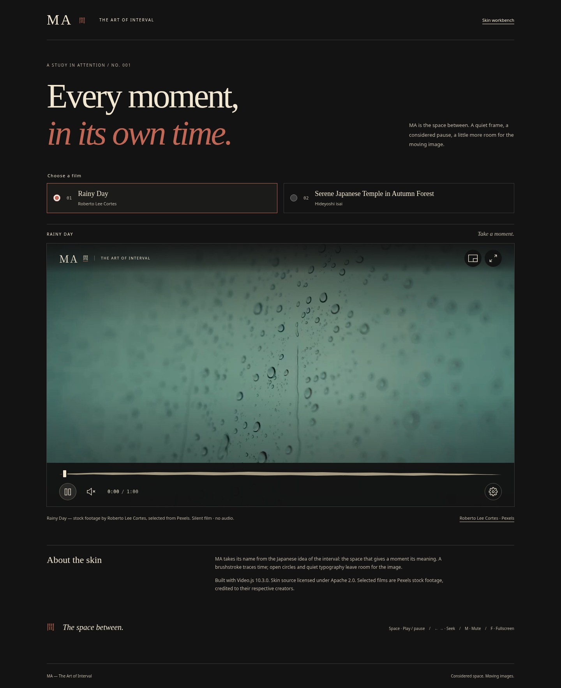
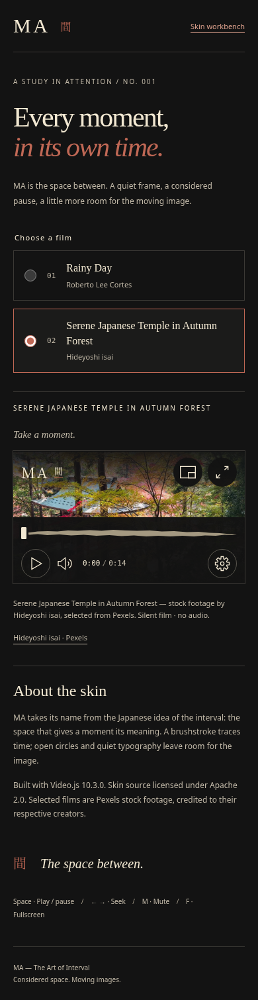

# MA — The Art of Interval (間)

**A considered pause. A brushstroke through time.**

MA is an original, working **Video.js 10.3.0** skin built with React, TypeScript and CSS. Inspired by the Japanese concept of *ma* (間)—the meaningful interval between moments—it gives moving images space to breathe without sacrificing familiar, accessible video controls.

**[Watch the live MA demo](https://ma-videojs-skin1.vercel.app/)** · [Explore the technical workbench](https://ma-videojs-skin1.vercel.app/workbench/) · [Design direction](design/spec.md)



## What makes MA distinctive

- **A calligraphic timeline:** a hand-drawn brush silhouette for buffer/progress, built on the *actual* Video.js TimeSlider. A 48 px seek target, accurate pointer/keyboard seeking and accessible time values remain intact.
- **A quiet visual language:** charcoal (#131313), warm ivory (#F2E8D2) and restrained vermilion (#C06855); editorial typography, an open-ring play affordance and an uncluttered 16:9 composition.
- **Two genuine demo films:** *Rainy Day* (60.143 seconds, Roberto Lee Cortes) and *Serene Japanese Temple in Autumn Forest* (14 seconds, Hideyoshi isai). Switch sources without navigation or replacing the native media node. Both are silent stock footage, credited separately from the code license.
- **Practical accessibility:** keyboard shortcuts, visible focus, touch controls, reduced-motion support, contrast/forced-colors treatments, status announcements, error handling, settings and focus return.
- **Real cross-browser QA:** Chromium/Chrome, Firefox and WebKit engine tests, responsive players down to 240 px, desktop layouts up to 2560 px, real-media decoding and playback, and an automated publicly accessible Vercel Preview check.

This is a **real Video.js v10 skin**, not a static mockup or a CSS overlay on an unrelated player.

## See it in action

| Desktop | Narrow player |
| --- | --- |
|  |  |

**[Launch the public player](https://ma-videojs-skin1.vercel.app/)** — choose a film, play, seek, pause, mute, open settings, try fullscreen and navigate using the keyboard. The workbench exposes player widths, languages, ratios and interaction states.

The sample videos have **no audio streams**. Standard volume/mute controls remain in the reusable skin, but they will not produce sound for these two selected samples.

## Try the project

Requirements: Node.js 24 and npm.

```sh
npm ci
npm run typecheck
npm run build
npm run preview
```

Development server: `npm run dev`. To run browser regression tests after the build:

```sh
npx playwright install chromium
npm test
```

The `npm ci` postinstall applies a **version-specific patch for `@videojs/core@10.3.0`** to fix volume-popover focus/hover during its closing transition. This patch has a regression test and is documented in [patches/README.md](patches/README.md); do not remove it without checking upstream behavior and rerunning tests.

## Reusing the skin

MA is built on the official Video.js v10 **React Scaffold**. The portable player interface is implemented in `src/video/skin.tsx` and `src/video/`; its design layer is `src/video/ma.css`. Reuse these together with the supporting generated `src/styles/` and `src/lib/` modules rather than copying only a landing-page stylesheet.

- `apps/preview/src/demo/` — public editorial demo and film selector.
- `apps/preview/src/films.ts` — two credited, switchable demonstration sources.
- `apps/preview/public/media/pexels/` — actual MP4 and poster assets.
- `apps/preview/workbench/` — technical workbench.
- `tests/` — real-media, keyboard/touch, responsive, desktop-browser and accessibility checks.
- `design/` and `docs/` — concept, visual specifications, validation evidence and attribution.

The code honors standard media custom properties such as `--media-accent-color` and `--media-border-radius`. The full scaffold retains functional playback primitives; MA changes their presentation and interaction details.

## Compatibility, testing and limitations

MA has been tested using real H.264 media and postimages (not only fixtures), playback/seek/replay, volume state, film switching, fullscreen, hover/keyboard/focus, 240–390 px mobile layouts, desktop layouts from 1280×720 to 2560×1440, and automatic axe accessibility checks. GitHub Actions runs Chromium and desktop Firefox/WebKit suites; a public Vercel Preview test checks the deployed revision and both real films.

**Do not confuse browser emulation with device certification:** physical iPhone/Safari, assistive technology and the complete range of browser versions have not been independently certified. We report tested engines and scenarios, not universal compatibility.

- [Desktop-browser QA and screenshots](docs/DESKTOP-QA.md)
- [Real-video playback/metadata QA](docs/PR7-REAL-MEDIA-QA.md)
- [Technical workbench](docs/WORKBENCH.md)

## Rights and authorship

**Source code:** [Apache License 2.0](LICENSE) (see [NOTICE](NOTICE)).

**Demonstration media:** [Pexels License](https://www.pexels.com/license/), **not Apache 2.0 and not CC0**:

- [Rainy Day](https://www.pexels.com/video/rainy-day-26857124/) — Roberto Lee Cortes.
- [Serene Japanese Temple in Autumn Forest](https://www.pexels.com/video/serene-japanese-temple-in-autumn-forest-34948034/) — Hideyoshi isai.

These stock videos are **not original cinematography by the MA author**. The separate MDN CC0 sample is used for the technical workbench. Film and poster attribution is described in [docs/PEXELS.md](docs/PEXELS.md) and [NOTICE](NOTICE). No third-party music was added.

## Competition

Developed for the [Contra Video.js Skins Design Challenge](https://contra.com/community/topic/videojsskinschallenge). The skin is presented through a publicly accessible live site; **publishing a site is not the same as submitting the official contest entry**. Submission requires a separate confirmed action on Contra. No Mux-hosting bonus is claimed unless actually implemented and verified.

---

**MA (間) — give the interval its meaning.**
